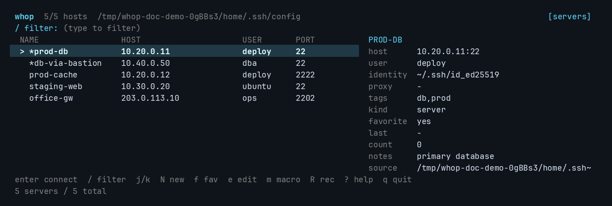
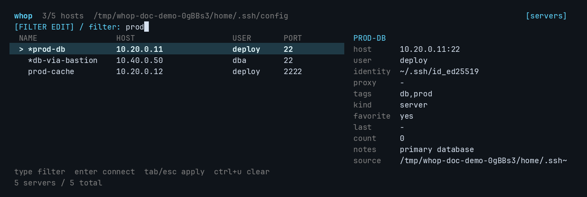
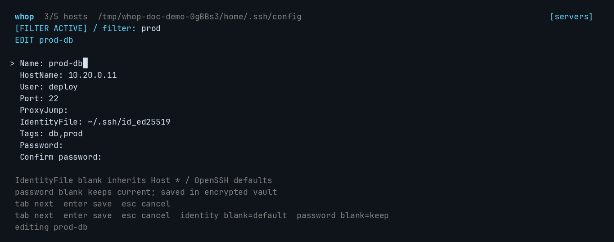
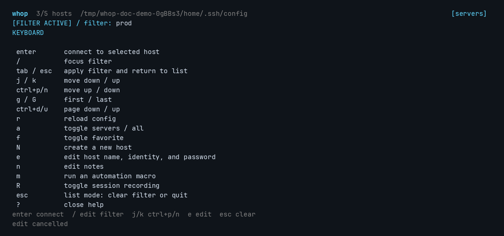
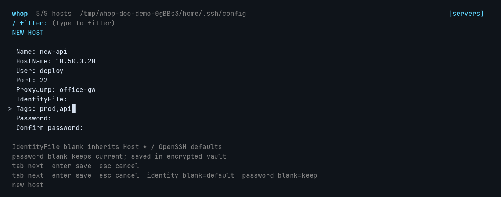
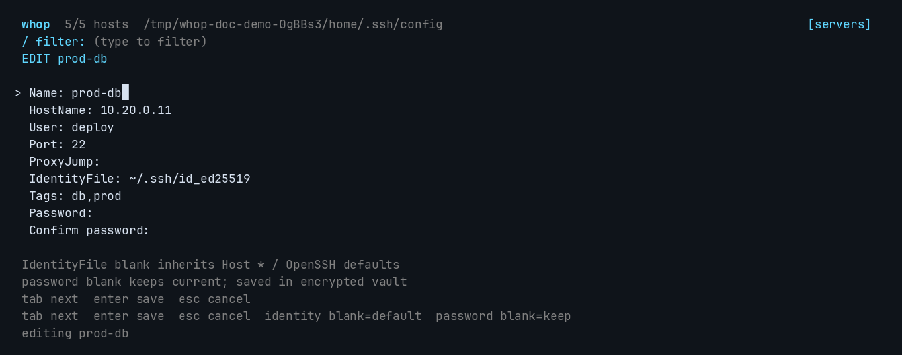
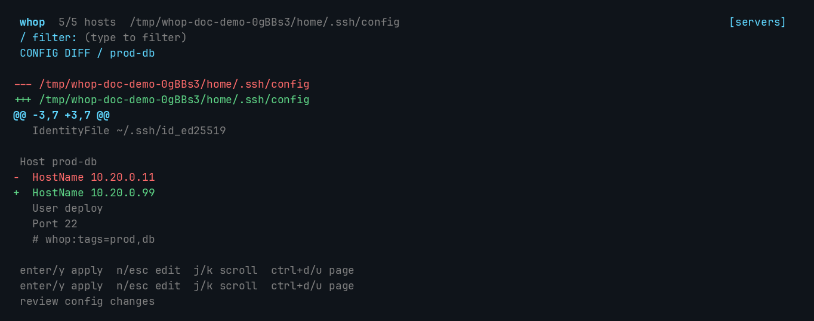
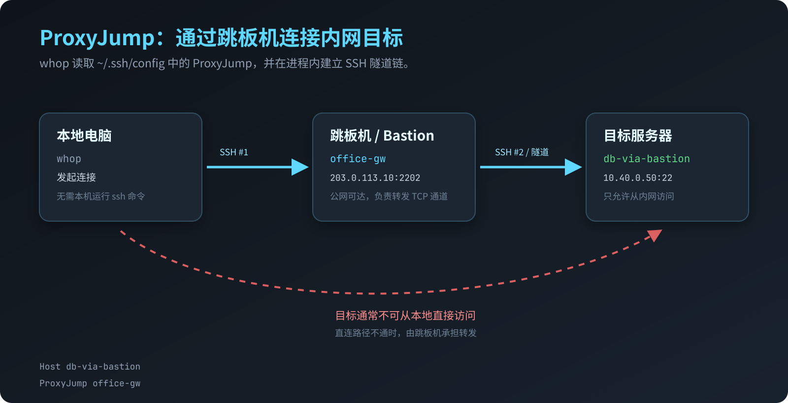
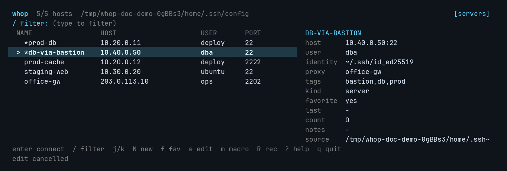
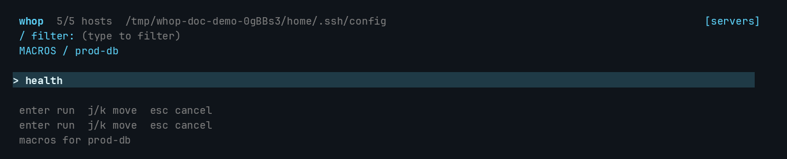

# whop 使用手册

> 适用版本：当前仓库构建的 `0.1.0-dev`  
> 本文截图来自真实运行的 whop TUI；演示使用隔离的临时 HOME、演示 SSH 配置和假地址，不包含真实凭据。

## 目录

1. [whop 是什么](#1-whop-是什么)
2. [TUI 快速上手](#2-tui-快速上手)
3. [新建、编辑、重命名服务器](#3-新建编辑重命名服务器)
4. [ProxyJump / host proxy 是什么](#4-proxyjump--host-proxy-是什么)
5. [默认 SSH 密钥](#5-默认-ssh-密钥)
6. [加密密码 vault](#6-加密密码-vault)
7. [收藏、标签、备注、登录能力](#7-收藏标签备注登录能力)
8. [会话录制、回放、全文搜索](#8-会话录制回放全文搜索)
9. [Snippet 与批量执行](#9-snippet-与批量执行)
10. [Macro 与 expect 自动化](#10-macro-与-expect-自动化)
11. [审计日志](#11-审计日志)
12. [ZMODEM 文件传输](#12-zmodem-文件传输)
13. [连接诊断](#13-连接诊断)
14. [端口转发与 SFTP](#14-端口转发与-sftp)
15. [nccm 配置迁移](#15-nccm-配置迁移)
16. [当前版本边界](#16-当前版本边界)
17. [排障速查](#17-排障速查)
18. [安全模型](#18-安全模型)

---

## 1. whop 是什么

whop 是一个本地优先的终端连接工作台：

- 以 `~/.ssh/config` 为 SSH 连接参数的唯一来源；
- 提供快速筛选、连接、收藏、标签、备注；
- 提供带 diff 预览的安全配置编辑；
- 使用纯 Go SSH 实现连接、ProxyJump、密码/密钥认证；
- 可以录制会话、搜索历史输出；
- 可以保存片段、批量执行命令、运行 expect 风格宏；
- 支持加密密码 vault、审计日志、ZMODEM 和结构化诊断。

它不是一个云平台，也不要求登录账号。默认不采集遥测，不会在启动时联网探测主机。

### 高级功能分别解决什么问题

| 功能 | 解决的问题 | 实际效果 |
|---|---|---|
| ProxyJump | 目标机只在内网，不能直接 SSH | 先连接公网跳板机，再通过 SSH 通道访问目标 |
| 安全编辑 + diff | 手改 `~/.ssh/config` 容易破坏无关配置 | 只改目标 Host 块；预览、加锁、哈希校验、备份、原子替换 |
| 新建/复制/重命名 Host | 配置项多，手工写容易漏字段 | 表单创建或复制 Host；重命名时迁移收藏、备注、标签和 vault 密码 |
| 默认 IdentityFile | 每台新机器都重复写同一个私钥路径 | `Host *` 设置一次，新 Host 留空即可继承 |
| 加密 vault | 多台机器反复输入密码；明文保存又不安全 | 主机密码进入 Argon2id + AES-256-GCM 加密 vault |
| 会话录制/搜索 | 出故障后翻历史终端输出很困难 | 保存 `.cast`，生成可搜索 `.txt`，内置回放 |
| Snippet/批量执行 | 同一命令要在多台机器重复执行 | 保存命名命令，一次在多个 alias 上执行 |
| Macro/expect | 登录、设备初始化、交互式命令无法简单批处理 | 按 wait/send/sleep 顺序自动操作终端 |
| 审计日志 | 自动化执行后不知道哪一步失败 | 记录宏生命周期、步骤、失败类别，不保存命令正文/输出 |
| ZMODEM | 某些跳板机/串口设备只支持 ZMODEM | 在 SSH 会话中收发 `rz`/`sz` 文件 |
| diagnose | SSH 失败只显示一句 `EOF` 或 `permission denied` | 标记 dial、handshake、auth、host_key、pty、automation 等阶段并给提示 |

---

## 2. TUI 快速上手

打开：

```bash
whop
```

直接带筛选词：

```bash
whop prod
```



### 最常用路径

1. 按 `/` 进入过滤模式，再输入文字过滤；
2. 过滤后按 `tab` 或 `esc`，应用过滤并回到列表操作模式；
3. `j` / `k` 或 `ctrl+n` / `ctrl+p` 移动；
4. `enter` 连接；
5. `/` 重新聚焦过滤框；
6. `q` 退出。

过滤输入模式下，字母始终属于过滤文本。例如：

```text
/ -> 输入 prod -> tab -> e
```

这样可以编辑过滤后的 `prod-db`。按 `tab` 或 `esc` 退出输入模式不会清空过滤结果；在列表操作模式再按 `esc` 才清空过滤，退出请按 `q`。

过滤输入模式：



按 `tab` 或 `esc` 后再按 `e`，编辑对象就是过滤后选中的主机：



### 完整按键



| 按键 | 作用 |
|---|---|
| `enter` | 连接当前服务器 |
| `/` | 聚焦筛选 |
| `j` / `k` 或 `ctrl+n` / `ctrl+p` | 下移 / 上移 |
| `g` / `G` | 第一条 / 最后一条 |
| `ctrl+d` / `ctrl+u` | 翻页 |
| `r` | 重新读取 SSH 配置 |
| `a` | 在“登录主机”和“全部 Host”之间切换 |
| `L` | 标记自动 / 可登录 / 服务端点 |
| `f` | 收藏 / 取消收藏 |
| `N` | 新建 Host |
| `c` | 复制当前 Host |
| `e` | 编辑 Host |
| `n` | 编辑备注 |
| `p` | 配置本地 / 远程 / 动态端口转发 |
| `s` | 打开 SFTP 双窗格文件浏览器 |
| `m` | 选择并运行宏 |
| `R` | 切换当前主机的录制策略 |
| `?` | 打开帮助 |
| `tab` / `esc` | 在过滤输入模式下应用过滤并返回列表操作 |
| `esc` | 在列表操作模式下清空过滤 |
| `q` | 退出 |

`a` 很重要：默认列表只显示可登录主机，隐藏通配符、`Match` 和自动识别出的 Git/Auth 服务端点。按 `a` 查看全部具体 Host；在全部模式下按 `L` 可以手动纠正某个 Host 的登录能力。

---

## 3. 新建、编辑、重命名服务器

### 新建 Host

按 `N`：



表单字段：

- `Name`：SSH 别名，也就是 `Host xxx`；
- `HostName`：真实 IP 或域名；
- `User`：登录用户；
- `Port`：SSH 端口；
- `ProxyJump`：跳板机别名；
- `IdentityFile`：私钥路径；
- `Tags`：whop 本地标签；
- `Password` / `Confirm password`：可选的 vault 密码。

表单内按 `tab` / `enter` 移到下一项，按 `ctrl+s` 保存并进入 diff 预览，按 `esc` 取消。

保存后会先显示 diff，确认后才写入。

### 复制 Host

选中一台已配置好的主机，按 `c`：

- `Name` 自动填成不冲突的 `<原名>-copy`（重复复制时为 `-copy-2`、`-copy-3`）；
- `HostName`、`User`、`Port`、`ProxyJump`、可解析的单个 `IdentityFile` 和 `Tags` 会一并带入；
- 进入表单后，已填字段在获得焦点时默认全选，直接输入即可替换；按 `tab` / `enter` 跳过则保留原值；
- 修改 `Name` 和 `HostName` 后按 `ctrl+s`，仍然先看 diff，再确认写入。

复制不会带入 vault 密码、收藏、备注、最近连接记录或连接次数，避免把新主机和旧主机的身份、历史混在一起。若源 Host 解析出多个 `IdentityFile`，表单会留空并提示手动确认，避免只复制其中一把密钥而静默改变认证行为。

对于大量“同一把密钥、不同 IP”的局域网主机，如果源 Host 只解析出一把密钥（包括从 `Host *` 继承的情况），复制表单会把它带入，确保新主机的认证方式不变。若希望新主机继续依赖 `Host *` 继承、以后换密钥只改一处，保存前清空复制表单里的 `IdentityFile` 即可。共享密钥的集中配置方式见下文“默认 SSH 密钥”。

### 编辑 Host

按 `e`：



可以修改：

- `Name`；
- `HostName`；
- `User`；
- `Port`；
- `ProxyJump`；
- `IdentityFile`；
- `Tags`；
- 密码。

修改 `Name` 不只是改显示文字，它会重写 `Host` 行中的别名，并同步迁移本地收藏、备注、标签、最近连接记录和 vault 密码。

### diff 确认



按 `enter` 或 `y` 应用；按 `n` / `esc` 回到表单。

安全机制：

- 只修改目标 Host 块，不解析后整体重写文件；
- 保留无关注释、空行、缩进和其他 Host；
- 使用配置锁；
- 预览带原文件哈希，文件被别人改动时拒绝应用；
- 写入前创建时间戳备份；
- 同目录临时文件 + fsync + 原子替换；
- 保留文件权限，并正确处理符号链接。

### 标签和备注要放哪里？

- `Tags` 存在本地 SQLite，也兼容配置里的 `# whop:tags=prod,db`；
- `Notes` 只存本地 SQLite；
- 密码只进入 vault；
- 私钥内容不会被读取或复制。

---

## 4. ProxyJump / host proxy 是什么

你说的 `hostpoxy` / host proxy，在 whop 和 OpenSSH 语境里通常对应 **ProxyJump**，中文常叫“跳板机”“堡垒机转发”或“主机代理”。

它不是 HTTP 代理，也不是 SOCKS 代理，而是：

> 本地先 SSH 登录一个可访问的跳板机，再让跳板机建立到目标机的 TCP 通道；whop 在这个通道上完成对目标机的 SSH 握手和认证。



### 它解决什么问题

典型场景：

```text
你的电脑 -> 公网跳板机 -> 内网数据库/生产服务器
```

内网服务器没有公网 IP，或者防火墙只允许跳板机访问。你不需要先手工登录跳板机再执行 `ssh`，whop 会自动建立整条链路。

### 配置示例

```sshconfig
Host office-gw
  HostName 203.0.113.10
  User ops
  Port 2202
  IdentityFile ~/.ssh/id_ed25519

Host db-via-bastion
  HostName 10.40.0.50
  User dba
  ProxyJump office-gw
```

然后在 whop 中选择 `db-via-bastion` 连接即可。



右侧 `proxy` 会显示 `office-gw`。

### 支持的跳板写法

```sshconfig
# 使用配置中的 alias
ProxyJump office-gw

# 覆盖跳板用户名
ProxyJump ops@office-gw

# 覆盖跳板端口
ProxyJump office-gw:2222

# 同时覆盖用户名和端口
ProxyJump ops@office-gw:2222

# 多级跳板：本地 -> edge-gw -> office-gw -> 目标
ProxyJump edge-gw,office-gw
```

OpenSSH 会按从左到右的顺序依次访问跳板机。因此上例先连接 `edge-gw`，再由它连接 `office-gw`，最后连接目标机。也可以让每个 Host 分别设置自己的 ProxyJump，形成嵌套链路。

### 效果和限制

会发生的：

- whop 分别完成每一跳的 SSH 认证和 host key 校验；
- 目标机的密码/密钥认证在隧道建立后继续执行；
- 连接、命令执行、宏和 ZMODEM 都可以复用同一条 ProxyJump 链。

不会发生的：

- 不调用本机 `ssh` 命令；
- 不要求运行 `ProxyCommand`；
- 不会自动把你的机器变成 SOCKS/HTTP 代理；
- 不支持 `ProxyCommand` 和 `Match exec`，因为它们依赖外部程序。

常见失败原因：

- 跳板机本身不可达；
- 跳板机禁止 TCP forwarding；
- 跳板机或目标机 host key 不匹配；
- ProxyJump 指向自己或形成循环；
- alias 拼错，无法从 `~/.ssh/config` 解析。

---

## 5. 默认 SSH 密钥

如果所有机器默认使用同一把私钥，可以在 `~/.ssh/config` 顶部设置：

```sshconfig
Host *
  IdentityFile ~/.ssh/id_ed25519
```

然后新建 Host 时把 `IdentityFile` 留空。whop 不会为新 Host 写 `IdentityFile`，连接时由 OpenSSH 配置继承规则补上默认值。

这样做的好处：

- 不用每台机器重复填写路径；
- 以后换默认密钥只改一处；
- 可以通过 `Host prod-*` 等更具体的块覆盖默认值；
- TUI 中看到的 `identity` 是解析后的最终结果。

适合多把密钥的做法：

```sshconfig
Host *
  IdentityFile ~/.ssh/id_ed25519

Host legacy-*
  IdentityFile ~/.ssh/id_rsa_legacy
```

---

## 6. 加密密码 vault

### 为什么需要

SSH 密码如果留在 shell history、脚本参数或明文配置里，很容易泄漏。whop 的 vault 把主机密码加密保存在本地文件里。

初始化：

```bash
# 每次进程启动时输入 master password
whop vault init

# 或者生成 0600 本地自动解锁 key，之后不再输入 master password
whop vault init --auto-unlock
```

设置密码：

```bash
whop vault set prod-db
whop vault list
whop vault status
whop vault delete prod-db
```

TUI 的 `e` 编辑表单也可以填写密码。密码留空表示不修改。

### 加密方式

- Argon2id 派生密钥；
- AES-256-GCM 认证加密；
- vault 文件权限 `0600`；
- 密码不会写进 `~/.ssh/config`、SQLite、日志、审计事件或命令行参数。

### 自动化环境变量

```bash
WHOP_VAULT_PASSWORD='master-password' whop connect prod-db
WHOP_VAULT_PASSWORD='master-password' WHOP_HOST_PASSWORD='host-password' whop vault set prod-db
```

注意：环境变量可能被同一用户下的其他进程读取。它们主要用于自动化，不建议在普通交互使用中长期 export。

### 安全边界

`--auto-unlock` 生成一个本地 key 文件。vault 仍然是密文，但拿到这个 key 文件的人可以直接解密。因此它比每次输入 master password 弱。master password 丢失后无法恢复 vault。

---

## 7. 收藏、标签、备注、登录能力

命令行：

```bash
whop favorite prod-db on
whop tag prod-db prod db
whop note prod-db "primary database"
whop record prod-db on
whop access github.com service
```

查询：

```bash
whop favorite prod-db off
whop tag prod-db                # 打印当前标签
whop note prod-db               # 打印当前备注
whop access github.com          # 查看 access / effective
```

TUI：

- `f`：收藏；
- `n`：编辑备注；
- `e` 表单中的 `Tags`：编辑标签。
- `L`：标记登录能力，可选 automatic / login host / service endpoint。

用途：

- 收藏让常用主机排在前面；
- 标签参与筛选，例如输入 `prod db`；
- 备注记录用途、负责人、变更窗口等非敏感信息。
- 登录能力默认自动判断；手动标记优先于自动判断。`service` 会从默认登录列表隐藏，`auto` 恢复自动判断。

不要在这些字段里保存密码或 token。

---

## 8. 会话录制、回放、全文搜索

### 录制

TUI：

1. 选中主机；
2. 按 `R`，界面显示 `rec`；
3. 按 `enter` 连接。

CLI：

```bash
whop record prod-db on
whop connect prod-db
whop connect -record prod-db
```

`R` 修改的是当前主机的持久化录制策略；`whop record <alias> on|off` 提供等价的 CLI 操作。`-record` 仍然可以作为单次显式覆盖。

默认目录：

```text
~/.config/whop/recordings/
```

每次会话生成：

- `<alias>-YYYYMMDD-HHMMSS.mmm.cast`：asciicast v2，保留终端控制序列；
- `<alias>-YYYYMMDD-HHMMSS.mmm.txt`：去掉 ANSI 的纯文本 transcript。

默认只记录远端输出，不单独记录输入。transcript 默认会脱敏常见的 password/token/API key 赋值和 Authorization 头。`.cast` 为忠实回放不会改写。

> 重要：即使不录输入，远端 shell 回显的命令也可能出现在输出里。录制期间不要输入不必要的密钥。

### 回放

```bash
whop replay ~/.config/whop/recordings/prod-db-*.cast
whop replay -speed 4 ~/.config/whop/recordings/prod-db-*.cast
```

回放使用内置 VT 模拟器，不依赖 `asciinema`。

### 建立搜索索引

```bash
whop index
whop index --no-prune
whop index -dir /path/to/recordings
```

索引使用 SQLite FTS5 trigram，可搜英文和中文子串。

### 搜索

```bash
whop search "error"
whop search --no-sync "timeout"
whop search --files "error"
whop search -json "error"
```

区别：

- 默认 `search` 先同步录制目录，再查 FTS5；
- `--no-sync` 只用已有索引，速度更快；
- `--files` 退回逐行扫描 `.txt`，适合索引不可用时排查；
- `-json` 输出结构化结果，适合脚本和 agent。

如果录制目录不存在，先连接并录制一次，或显式创建目录：

```bash
mkdir -p ~/.config/whop/recordings
```

---

## 9. Snippet 与批量执行

Snippet 是本地保存的命名远程命令。

```bash
whop snippet set disk "df -h"
whop snippet list
whop snippet run disk prod-db
```

一次在多个主机执行：

```bash
whop snippet run disk prod-db prod-cache staging-web
```

输出会用 `== alias ==` 分段。一个主机失败不会阻止其他主机继续执行，但最终退出码为非零。

适合：

- 批量查看磁盘、负载、服务状态；
- 对多台机器执行同一条巡检命令；
- 把常用只读命令做成短名字。

注意事项：

- 命令会作为远端命令执行，不是宏；
- 不要在命令字符串里硬编码密码；
- 需要交互的流程应该用 Macro。

也可以直接运行：

```bash
whop run prod-db uptime
whop run prod-db "systemctl status nginx"
```

---

## 10. Macro 与 expect 自动化

> 完整字段表、执行语义、JSON 转义和更多示例见 [Macro 语法与示例](macros.md)。

Macro 适合处理“等待一个提示符，再发送内容”的交互流程，例如：

- 登录旧式设备；
- 确认启动菜单；
- 等待 shell prompt 后执行巡检；
- 对固定的交互式 CLI 做自动化。

TUI 中按 `m`：



### 定义宏

创建 `health.json`：

```json
{
  "version": 1,
  "steps": [
    {"kind": "wait", "pattern": "\\$ $", "timeout": "10s"},
    {"kind": "send", "send": "uptime", "newline": true},
    {"kind": "wait", "pattern": "load average", "timeout": "10s"},
    {"kind": "send", "send": "df -h", "newline": true},
    {"kind": "sleep", "sleep": "500ms"}
  ]
}
```

保存和查看：

```bash
whop macro set health ./health.json
whop macro list
whop macro show health
```

运行：

```bash
whop macro run --timeout 30s health prod-db
whop macro run -json health prod-db
```

### 三种步骤

| `kind` | 作用 | 关键字段 |
|---|---|---|
| `wait` | 等待输出匹配正则 | `pattern`、`timeout`、可选 `retries` |
| `send` | 向远端发送文本 | `send` 或 `secret_env`、`newline` |
| `sleep` | 等待固定时间 | `sleep`，例如 `500ms`、`2s` |

### 密码和 token

不要把密码直接放进 `send`。使用环境变量引用：

```json
{"kind": "send", "secret_env": "WHOP_DEPLOY_PASSWORD", "newline": true}
```

运行时：

```bash
WHOP_DEPLOY_PASSWORD='...' whop macro run login prod-db
```

`secret_env` 只保存变量名。变量值在运行前解析，不写入 SQLite、审计日志或命令行参数。Macro 本身不是加密存储，因此普通 `send` 只适合非秘密命令。

### 注意事项

- `wait` 使用 Go 正则；
- 正则不能匹配空字符串；
- 单步 `wait` 超时和整体 `--timeout` 同时生效，整体超时是硬上限；
- 宏通过交互式 shell 执行，不代表完全替代普通 `whop run`；
- TUI 执行宏结束后会保留输出，按 Enter 才返回服务器列表；
- 设备 prompt 变化时优先修 pattern，而不是无限增加 sleep。

---

## 11. 审计日志

宏运行会记录生命周期事件：

```bash
whop audit
whop audit --limit 50
whop audit --json
whop audit clear
```

事件包括：

- `macro_started`；
- `macro_step` / `macro_step_done`；
- `macro_completed`；
- `macro_failed`，带失败阶段和类别。

日志不保存命令正文或终端输出，因此适合回答“哪个宏在哪台机器哪一步失败”，不适合替代会话录制。

---

## 12. ZMODEM 文件传输

ZMODEM 适合某些路由器、交换机、串口网关和老式 Unix 环境。远端需要支持 `rz` / `sz`。

### 上传

```bash
whop zmodem put prod-db ./backup.tar
whop zmodem put --overwrite prod-db ./firmware.bin
```

远端执行 `rz`（overwrite 时 `rz -y`），whop 在进程内完成 ZMODEM 发送。

### 下载

```bash
whop zmodem get prod-db /var/log/syslog
whop zmodem get -dest ./downloads prod-db /var/log/syslog
whop zmodem get -max-size 104857600 prod-db /var/log/big.log
```

远端路径相对于 SSH 用户的 home 目录；建议直接使用完整路径。远端命令失败时，
错误信息会随 whop 的错误一起显示。

默认下载到：

```text
~/Downloads/whop/<alias>/
```

### 交互式会话自动拦截

在普通 SSH 会话中：

- 远端运行 `rz` 时，whop 暂停终端并询问本地文件；
- 远端运行 `sz FILE` 时，whop 自动接收并保存到默认下载目录。

限制：

- 远端必须有 `rz`/`sz`；
- ZMODEM 是可选能力，不是所有 SSH 主机都支持；
- 交互式下载当前不限制文件大小；手动下载可用 `-max-size` 限制；
- 交互式下载默认不覆盖同名文件，重试前先移走旧文件；手动下载可用
  `whop zmodem get --overwrite`。

交互式传输期间按 `Ctrl-C` 会发送 ZMODEM 取消。成功完成后返回 shell；
传输失败或被取消时会结束当前 SSH 会话，避免远端残留的 ZRINIT 被 shell
当成命令执行（TUI 会自动回到主机列表）。握手阶段单次读取超过 30 秒会
重试，达到重试上限后中止；数据传输阶段 60 秒没有进展会中止，不会永久挂起。

### 调试

自动识别失败时，可以开启 ZMODEM 调试日志：

```bash
WHOP_ZMODEM_DEBUG=1 whop connect prod-db
```

日志会输出检测到的帧类型、十六进制头和头部前 64 字节，便于判断远端
`sz` 使用的是十六进制头还是二进制头。头部可能包含远端文件名。

---

## 13. 连接诊断

```bash
whop diagnose prod-db
whop diagnose -json prod-db
```

它只建立 SSH 连接、完成 handshake 和认证，然后关闭，不打开交互 shell。

失败时输出阶段、类别和提示，例如：

- `dial`：DNS、路由、端口不可达；
- `handshake`：协议/算法不匹配、连接被重置；
- `auth`：密钥、agent、密码或用户名错误；
- `host_key`：known_hosts 不匹配；
- `jump`：ProxyJump 某跳失败；
- `pty` / `session`：对端不提供交互 shell；
- `automation`：宏等待超时或流提前关闭。

机器可读：

```bash
whop diagnose -json prod-db
whop connect -json prod-db
whop macro run -json health prod-db
```

---

## 14. 端口转发与 SFTP

### 端口转发

本地转发：

```bash
whop forward -L 127.0.0.1:8080:db.internal:5432 prod-db
```

远程转发：

```bash
whop forward -R 9000:localhost:3000 prod-db
```

动态 SOCKS5 转发：

```bash
whop forward -D 127.0.0.1:1080 prod-db
```

语法与 OpenSSH 类似：

- `-L [bind:]port:host:port`
- `-R [bind:]port:host:port`
- `-D [bind:]port`

默认绑定 `127.0.0.1`。绑定到 `0.0.0.0` 或 `::` 会把服务暴露给其他机器，动态转发本身不带认证，必须显式确认网络边界。多个 `-L` / `-R` / `-D` 可以同时给出；进程运行到收到 `Ctrl+C` 为止。

TUI 中选中主机按 `p`，填写类型、绑定地址和目标地址后按 `ctrl+s` 启动；退出转发后会自动回到主机列表。

### SFTP 双窗格

```bash
whop sftp prod-db
```

也可以在主列表按 `s`。浏览器左侧是本地目录，右侧是远端目录：

- `tab`：切换窗格；
- `j/k`、方向键：移动；
- `enter` / `right`：进入目录；
- `backspace` / `left`：返回上级；
- `u`：上传当前本地文件；
- `d`：下载当前远端文件；
- `r`：刷新；
- `q` / `esc`：关闭。

上传和下载都拒绝覆盖已有目标文件；失败时会清理未完成的临时目标。远端路径使用 SFTP 服务的当前目录作为默认起点。

---

## 15. nccm 配置迁移

如果你有 nccm YAML：

```bash
# 先预览，不写入
whop import nccm --json

# 只迁移指定连接
whop import nccm --only prod-db,prod-cache --apply

# 迁移全部可安全转换的连接
whop import nccm --apply
```

它会：

- 导入 HostName、User、Port、IdentityFile、keepalive、注释等安全字段；
- 跳过已存在的 alias 和重复 endpoint；
- 将 nccm 的密码放入 vault；
- 对不支持的 customargs 给出 warning；
- 默认 dry-run，只有 `--apply` 才写配置。

---

## 16. 当前版本边界

必须区分“路线图”与“当前二进制实际可用能力”。

当前已经可用：

- SSH 交互连接；
- ProxyJump 单跳/多跳；
- 本地 / 远程 / 动态 SOCKS5 端口转发（CLI + TUI）；
- SFTP 双窗格浏览与上传下载（CLI + TUI）；
- 密码/私钥/keyboard-interactive 认证；
- ssh-agent（可选）；
- Host 新建、编辑、重命名、diff 预览；
- vault；
- 主机级录制策略、录制、回放、FTS5 搜索；
- Snippet、批量执行；
- Macro/expect；
- 审计日志；
- ZMODEM；
- diagnose；
- nccm 导入。

当前版本尚未提供用户可用的：

- `ProxyCommand` / `Match exec`；
- PKCS#11、GSSAPI、FIDO2、X11 forwarding；
- RDP/VNC；
- 云账号同步或团队托管。

README 的 V1 scope 和本文的“当前已可用/尚未提供”以实际 `whop help` 为准。

---

## 17. 排障速查

| 现象 | 先检查 |
|---|---|
| TUI 看不到某台机器 | 按 `a` 查看全部；若自动识别错误，按 `L` 标记 login/service |
| ProxyJump 失败 | 跳板机是否可达；是否允许 TCP forwarding；alias 是否存在；是否循环 |
| Authentication failed | IdentityFile、agent、vault 密码、用户名、服务器 auth policy |
| Host key failed | 用可信渠道核对 key 后更新 `~/.ssh/known_hosts` |
| 修改配置失败 | 文件是否被其他程序改动；查看 diff 后重试；检查 `.bak.*` |
| 密码改了但没生效 | 是否保存到 vault；master password 是否正确；是否有旧密码缓存 |
| 搜不到会话 | 是否录过会话；`whop index`；查询在 `.txt` 中是否存在 |
| 宏超时 | 用 `whop macro show` 检查 pattern；设备 prompt 是否变化 |
| ZMODEM 失败 | 远端是否有 `rz`/`sz`；权限、磁盘空间、目标目录 |
| 端口转发连不上 | 监听地址是否正确；代理端是否允许 TCP forwarding；目标地址是否从远端可达 |
| SFTP 打不开 | 服务端是否启用 SFTP subsystem；目标路径权限是否足够 |
| Git/Auth 主机无法交互 | 用 `whop run github.com help`，或 `whop access github.com service` 标记为服务端点 |

---

## 18. 安全模型

whop 的底线：

- 不把密码、passphrase、token 写进明文 SSH 配置；
- 不把密码写进 SQLite、日志、审计事件或命令行参数；
- 密码 vault 默认需要 master password；
- 主机 key 校验默认开启；
- 动态转发默认绑定 loopback，不内置 SOCKS 认证；
- 编辑配置前预览 diff；
- 配置写入使用锁、备份、fsync 和原子替换；
- 核心功能不依赖外部 `ssh`、`scp`、`sftp`、`asciinema` 等程序。

仍需注意：

- 已解锁的 vault 和运行中的进程无法防御同用户恶意软件；
- `--auto-unlock` 降低 master password 门槛；
- `.cast` 录制文件不会脱敏；
- 远端输出如果包含秘密，仍然会进入录制；
- 使用 `WHOP_VAULT_PASSWORD` 环境变量时，环境本身可能被同用户进程读取。

---

## 附：常用命令速查

```bash
# TUI
whop
whop prod
whop -record
whop -agent

# 主机列表 / 连接
whop list
whop list -json
whop connect prod-db
whop run prod-db uptime
whop diagnose -json prod-db

# 元数据
whop favorite prod-db on
whop tag prod-db prod db
whop note prod-db "primary database"
whop record prod-db on

# vault
whop vault init
whop vault init --auto-unlock
whop vault set prod-db
whop vault list
whop vault status
whop vault delete prod-db

# 转发 / 文件
whop forward -L 127.0.0.1:8080:db.internal:5432 prod-db
whop forward -R 9000:localhost:3000 prod-db
whop forward -D 127.0.0.1:1080 prod-db
whop sftp prod-db

# 录制 / 搜索
whop connect -record prod-db
whop replay ~/.config/whop/recordings/prod-db-*.cast
whop index
whop search "error"

# Snippet / 批量
whop snippet set disk "df -h"
whop snippet run disk prod-db prod-cache

# Macro
whop macro set health ./health.json
whop macro list
whop macro show health
whop macro run --timeout 30s health prod-db
whop audit --limit 50

# ZMODEM
whop zmodem put prod-db ./backup.tar
whop zmodem get prod-db /var/log/syslog

# 迁移
whop import nccm --json
whop import nccm --apply
```
